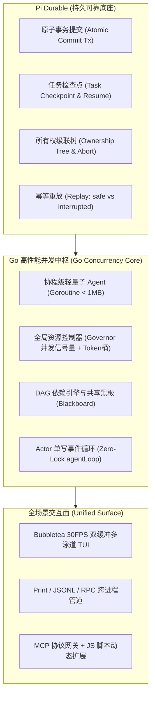
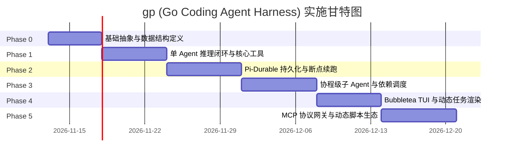

# `gp` (Go Coding Agent Harness) 实施落地与开发推进计划

> [!abstract] 核心战略定位
> 本计划深度融合 **Pi 1.0 的轻量模块化设计**、**Pi Durable 的崩溃恢复与原子事务架构（Crash-Resilience & Durability）**、以及 **Go 语言的 Goroutine 协程调度优势（Governor / Token Bucket / DAG 依赖引擎）**。
> 旨在以清晰、低耦合、敏捷闭环的节奏，打造一款单二进制交付、单 Agent 内存 < 1MB、支持无限长会话断点续跑、具备工业级稳定性的开源 Coding Agent Harness。

---

## 一、三位一体核心架构融合蓝图



---

## 二、六阶段分步实施里程碑（Milestone Roadmap）

总工期预计 **6 周**，采用**“核心闭环 $\rightarrow$ 持久韧性 $\rightarrow$ 协程并发 $\rightarrow$ 终端可视化 $\rightarrow$ 生态兼容”**的递进路线，每周均有可独立运行、可验收的最小可行产品（MVP）。



---

### 【Phase 0：基础设施与核心抽象】（第 1 周，5 个工作日）

> **阶段目标**：建立整洁规范的代码库，确立统一的类型定义、存储接口与工具契约，保证零循环依赖。

- [x] **Task 0.1：AI 抽象层规范（`internal/ai`）**
  - 完善 `Message`, `Role`, `ToolCall`, `TokenUsage`, `StreamChunk` 基础模型结构体；
  - 定义 `Provider` 接口（`Name()`, `StreamChat(ctx, req) (<-chan StreamChunk, error)`）；
  - 支持模型思考过程块（Thinking/Reasoning Delta）的捕获解析。
- [x] **Task 0.2：工具契约与沙箱上下文（`internal/tools`）**
  - 完善 `ToolContext`：强制绑定 `Cwd`、环境变量映射与事件通道，严禁全局状态；
  - 完善 `Registry`：支持白名单裁剪子集（`ScopedRegistry`）。
- [x] **Task 0.3：Durable 存储引擎抽象（`internal/core/storage`）**
  - 参考 Pi Durable 设计轻量事务接口：
    ```go
    type Storage interface {
        Commit(ctx context.Context, fn func(tx Transaction) error) error
        Close() error
    }
    type Transaction interface {
        AppendEntry(entry SessionEntry) error
        SetDocument(docKey string, val any) error
        GetDocument(docKey string) (any, bool)
        SaveCheckpoint(taskID string, state any) error
    }
    ```
  - 实现纯内存存储后端 `MemoryStorage`，用于单元测试与纯内存子 Agent。
- [x] **Task 0.4：配置管理（`internal/core/settings`）**
  - 解析 `~/.gp/settings.json` 与当前项目 `.gp/settings.json`，提供带优先级的层叠合并。
- **阶段验收标准（Gate M0）**：
  - `go test -v ./...` 单元测试通过率 100%；
  - 核心接口纯标准库实现，无外部重量级依赖引入。

---

### 【Phase 1：单 Agent 推理闭环与核心工具】（第 2 周，6 个工作日）

> **阶段目标**：实现首个大模型 Provider，打通核心文件与系统命令工具，跑通第一条完整的单 Agent 编码问答闭环。

- [x] **Task 1.1：首个大模型驱动实现（`internal/ai/providers/openai`）**
  - 基于标准 HTTP Client 实现兼容 OpenAI / DeepSeek / Moonshot 的流式 SSE 解析器；
  - 健全的 HTTP 超时控制与 `context.Context` 取消监听。
- [x] **Task 1.2：内置核心 Coding 工具集（`internal/tools/builtin`）**
  - `read`：支持 `offset`/`limit` 分页，带行号格式化，防爆流式截断（50KB / 2000行）；
  - `write`：原子写入（临时文件写入后 `os.Rename`）；
  - `edit`：精确字符串匹配替换，严格唯一性校验（防止误修改同名代码块）；
  - `bash`：基于 `exec.CommandContext` 执行命令，支持实时输出截获与超时强杀。
- [x] **Task 1.3：Agent 主循环引擎（`internal/agent/loop.go`）**
  - 实现经典的 ReAct 状态循环：
    `UserPrompt` $\rightarrow$ `Model Stream` $\rightarrow$ `ToolCall Request` $\rightarrow$ `Execute Tool` $\rightarrow$ `Append ToolResult` $\rightarrow$ `Model Stream` $\rightarrow$ `Finish`；
  - 遇到纯文本输出时收敛退出。
- [x] **Task 1.4：Print 运行模式对接（`internal/modes/print`）**
  - 完善 `gp -p "提示词"` 命令行管道直出逻辑。
- **阶段验收标准（Gate M1）**：
  - 运行 `gp -p "请用 read 工具读取 main.go 并做简要说明"`，程序自动调用 `read` 工具，成功将结果回填大模型并输出最终解释。

---

### 【Phase 2：Durable 持久化与断点续跑】（第 3 周，7 个工作日）

> **阶段目标**：全面注入 Pi Durable 核心精髓！支持 SQLite 事务持久化，实现进程中途被杀后重启能**断点续跑（Resume）**与**精确一次（Exactly-Once）提交**。

- [x] **Task 2.1：SQLite 存储后端实现（`internal/core/storage/sqlite`）**
  - 采用现代纯 Go 驱动（如 `modernc.org/sqlite`，无需安装 CGO gcc）；
  - 创建标准表结构：`entries`（不可变记录流）、`documents`（Typed JSON 状态）、`task_checkpoints`（任务检查点）；
  - 实现单进程 SQLite WAL 模式，确保写并发性能。
- [x] **Task 2.2：检查点与任务恢复（Task Checkpoint & Resume Engine）**
  - 任务状态机：`generation`（大模型生成）与 `tool_call`（工具执行）每一步执行前落盘 Checkpoint；
  - **幂等性与重放控制（Idempotent Replay）**：
    - 工具声明 `ReplayMode: "safe"`（只读工具如 `read`，重启后自动重新执行）；
    - 工具声明 `ReplayMode: "interrupt"`（有写副作用工具如 `bash`, `edit`，重启后不重复执行，而是向模型报告中断状态，由模型判断下一步）。
- [x] **Task 2.3：所有权级联树（Ownership Tree & Cascade Abort）**
  - 建立 Task 树形依赖结构；
  - 当收到 Abort 信号（如用户按 Esc 或上下文超时），**从底向上（Bottom-up）级联取消**所有子任务与关联工具。
- [x] **Task 2.4：CLI `gp resume` 命令实现**
  - 启动时扫描未完成任务，自动从最新 Checkpoint 恢复未竟的推理流水线。
- **阶段验收标准（Gate M2）**：
  - 在 Agent 正在执行耗时工具调用或模型流式生成时，使用 `kill -9` 强杀 `gp` 进程；
  - 重新执行 `gp resume`，程序准确识别出中断点，未完成任务自动续跑，数据无撕裂、会话记录完全连贯！

---

### 【Phase 3：Goroutine 级子 Agent 与依赖调度】（第 4 周，7 个工作日）

> **阶段目标**：实现 Goroutine 轻量子 Agent、全局资源调度器、共享黑板与 DAG 依赖触发引擎。

- [x] **Task 3.1：全局资源调度器（`internal/scheduler/governor.go`）**
  - 基于缓冲 Channel 实现高精度并发信号量（限制并行协程总数）；
  - 基于滑动窗口实现全局 Token 桶限流器（动态平滑 TPM/RPM 预算，彻底杜绝 429）。
- [x] **Task 3.2：动态元工具 `subagent`（LLM 自动触发）**
  - 向主 LLM 暴露 `subagent` 工具元数据；
  - 执行器捕获后，通过 `errgroup` 动态为 `tasks` 数组**并发启动轻量 Goroutine**；
  - 单协程内注入纯内存 `Session`（内存 < 1MB）与裁剪后的最小化工具集。
- [x] **Task 3.3：多 Agent 共享黑板（`internal/scheduler/blackboard.go`）**
  - 线程安全 KV 共享空间，Scout 沉淀的事实数据，自动供 Planner / Reviewer 按需拉取。
- [x] **Task 3.4：DAG 依赖图与自愈闭环（`internal/scheduler/dag.go`）**
  - 实现基于 `doneChan` 拓扑排序的 DAG 依赖唤醒引擎；
  - **自愈回路（Repair Loop）**：当 Verifier 测试失败时，自动重置 Implementer 并将错误日志作为输入重新触发修复，内置**两轮原则熔断器**。
- **阶段验收标准（Gate M3）**：
  - 主 Agent 面对复杂任务时，自主吐出 `subagent` 工具调用，Go 调度器在单进程内毫秒级并发派生 Scout 和 Reviewer 两个协程，结果正确聚合返回主 Agent，并发内存增量低于 5MB！

---

### 【Phase 4：Bubbletea TUI 与动态多任务渲染】（第 5 周，6 个工作日）

> **阶段目标**：打造丝滑、防闪烁、多任务泳道可视化的现代化终端交互体验。

- [x] **Task 4.1：Bubbletea 核心消息驱动模型（`internal/tui`）**
  - 确立 TEA 单向数据流架构，严禁协程直接写 stdout；
  - 引入 30 FPS 批量双缓冲刷新时钟（FPS Throttler），消除高频 Token 造成的终端闪烁。
- [x] **Task 4.2：独立虚拟屏幕缓冲区（Per-Agent Virtual Buffer）**
  - 为每个并发 Agent 分配独立的 Viewport 模型，彻底杜绝日志交织混乱；
  - 支持 `Tab` 键或快捷键平滑切换活跃 Agent 视口。
- [x] **Task 4.3：多任务动态悬浮托盘（Active Coroutine Tray）**
  - 屏幕底端固定悬浮渲染当前活跃的子协程摘要、动态 Spinner 旋转动画与执行耗时。
- [x] **Task 4.4：分栏双拼与 DAG 树状进度呈现**
  - 左侧 35% 渲染当前 DAG 任务树拓扑与状态徽标（`[RUNNING]`, `[BLOCKED]`, `[REPAIR]`, `[DONE]`）；
  - 右侧 65% 渲染当前聚焦 Agent 的详细 Diff 与代码生成现场。
- **阶段验收标准（Gate M4）**：
  - 在 TUI 界面发起多 Agent 并发任务，终端各区域无闪烁、无日志撕裂，用户可通过 Tab 键自由穿梭于主编排器与各个子 Agent 控制台之间。

---

### 【Phase 5：生态扩展与协议兼容】（第 6 周，7 个工作日）

> **阶段目标**：打通外部生态，接入 MCP 协议客户端、嵌入式 JS 动态脚本引擎与 Skills 知识库。

- [x] **Task 5.1：Model Context Protocol 客户端（`internal/mcp`）**
  - 支持基于 `stdio` 启动外部 MCP 服务子进程（如 gopls-lsp, git-mcp 等）；
  - 自动抓取其 `tools/list` 并动态转译注册为 `gp` 内部的 `Tool`。
- [x] **Task 5.2：嵌入式 JavaScript 脚本扩展（`internal/extensions/js`）**
  - 集成纯 Go 实现的 `dop251/goja` 脚本引擎；
  - 暴露 `gp.registerTool(...)` 等 API 给 JS，支持用户在不重新编译 Go 的情况下热加载 `.js` 扩展脚本。
- [x] **Task 5.3：Skills 与上下文文件加载（`internal/core/resources`）**
  - 扫描解析项目与全局目录下的 `SKILL.md`，按需注入系统提示词；
  - 解析 `AGENTS.md` / `CLAUDE.md` 注入工程守则。
- [x] **Task 5.4：跨平台编译与打包发布**
  - 编写 `Makefile` 与 GitHub Actions，支持静态交叉编译（`darwin-arm64`, `darwin-amd64`, `linux-amd64`, `windows-amd64`）。
- **阶段验收标准（Gate M5）**：
  - 能够成功加载现有的 MCP 服务并调用其工具；
  - 放入一段 `.js` 插件脚本，CLI 启动后自动识别并成功执行该工具。

---

## 三、关键风险识别与应对预案（Risk Mitigation）

| 风险项 | 潜在影响 | 架构应对预案 |
| :--- | :--- | :--- |
| **高并发协程下的文件写入竞争** | 多个子 Agent 同时编辑同一代码文件造成内容撕裂 | 引入 `FileMutationLockManager`（基于文件绝对路径的读写锁映射池），严格实行按文件粒度的并发写互斥。 |
| **大模型长文本下的内存泄漏与 GC 压力** | 长会话累积巨量字符串，导致高频 GC 停顿 | 1. 采用 `sync.Pool` 复用字符切片与缓冲区；<br/>2. 非活跃历史消息转入 SQLite 磁盘，内存仅保留活跃窗口。 |
| **外部工具僵尸进程残留** | Bash 工具超时或父协程 Abort 时命令脱离控制 | 采用 Linux/macOS 的 `Setpgid` 进程组机制，强杀时直接向整个进程组发送 `SIGKILL`，确保无残留孤儿进程。 |
| **大模型 API 429 速率熔断** | 多 Agent 瞬间并发触发服务商限流 | 全局 Governor 内置滑动窗口与指数退避重试（Exponential Backoff with Jitter），请求前强制排队。 |

---

## 四、本周立即启动任务（Sprint 1 行动项）

1. **第 1 天**：在 `/Users/pcong/Project/gp/internal/ai` 实现完整的 OpenAI 兼容 SSE 流式客户端，编写 Mock 测试。
2. **第 2 天**：在 `/Users/pcong/Project/gp/internal/tools/builtin` 完成 `read.go` 与 `write.go`，建立安全文件沙箱。
3. **第 3 天**：实现 `edit.go`（精确文本替换）与 `bash.go`（进程组命令执行与超时强杀）。
4. **第 4 天**：在 `/Users/pcong/Project/gp/internal/agent` 组装完成首版 `AgentLoop`，打通模型到工具调用的初次闭环。
5. **第 5 天**：在 `cmd/gp` 接入 Print 模式（`gp -p "..."`），实现端到端命令行真实测试！
