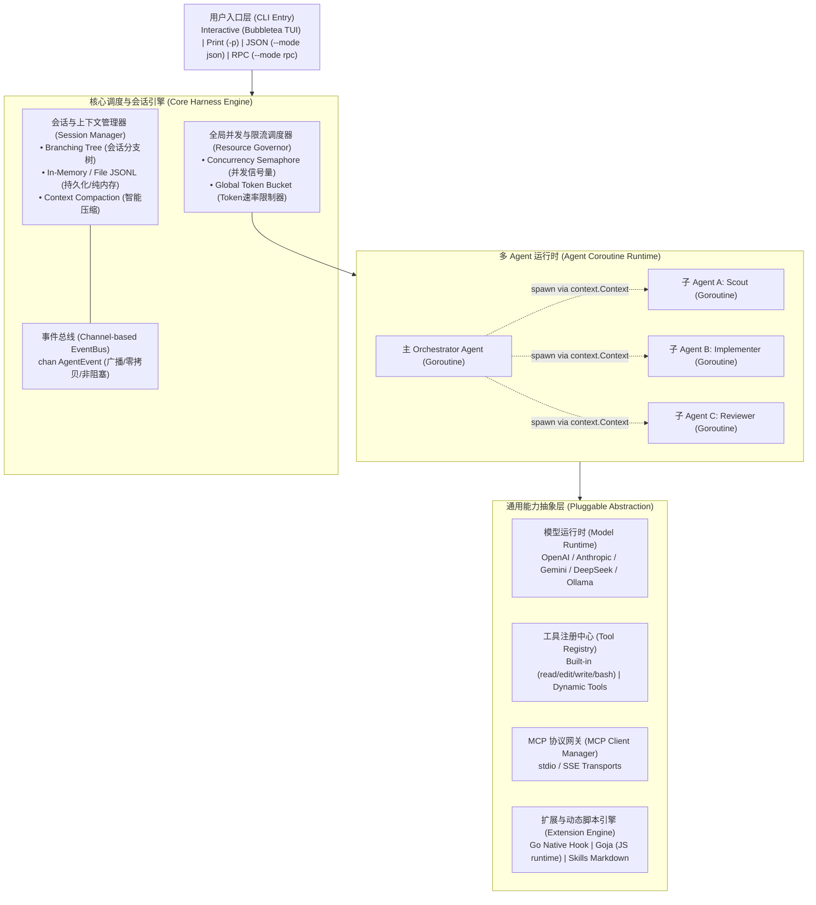
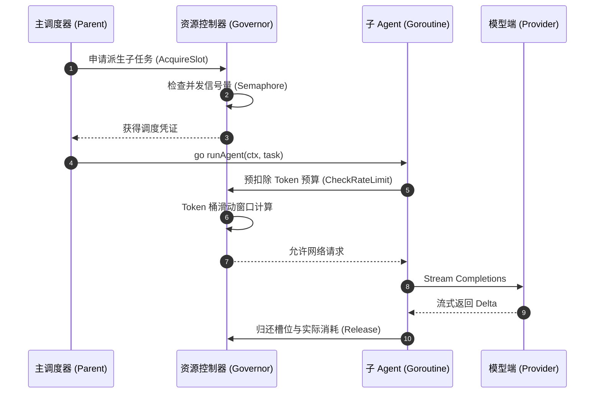
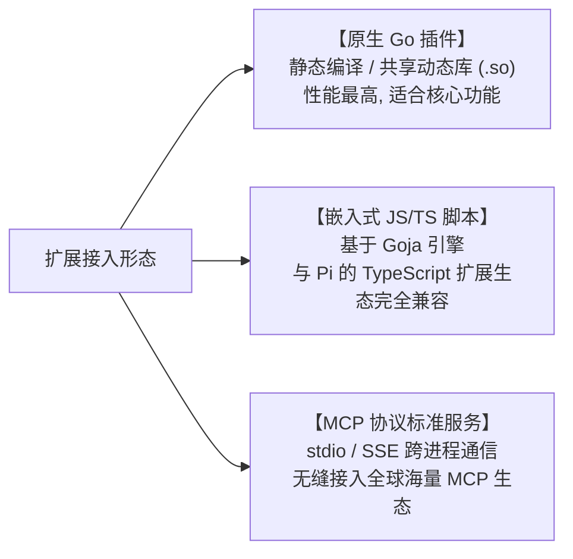
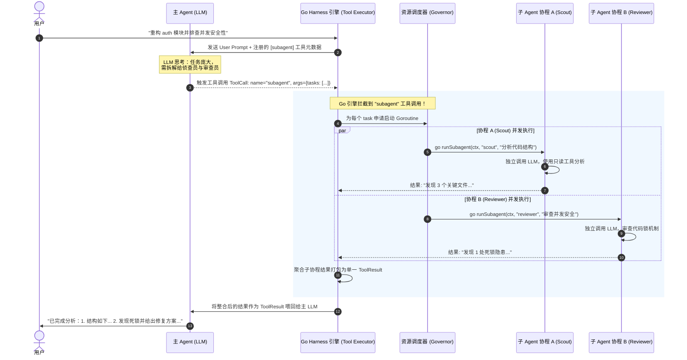
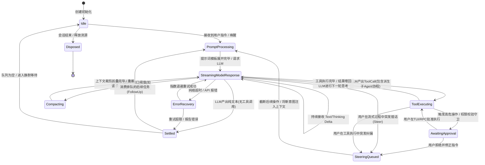
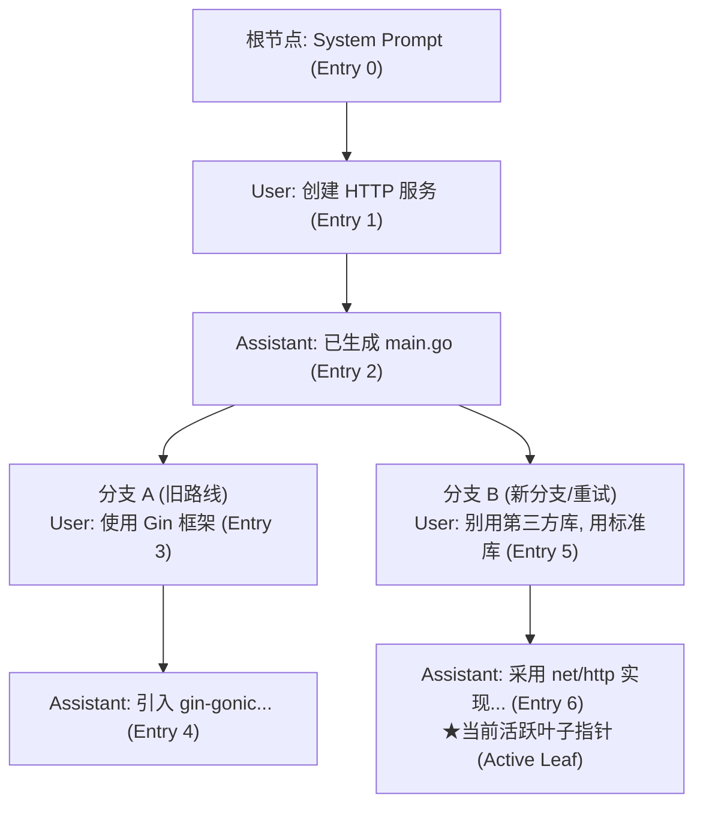
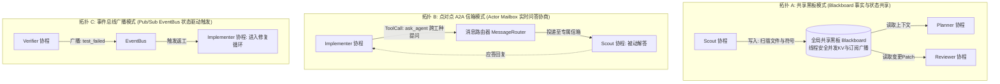
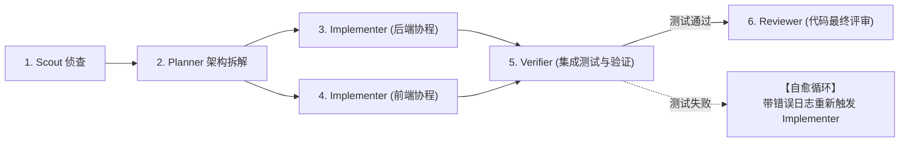
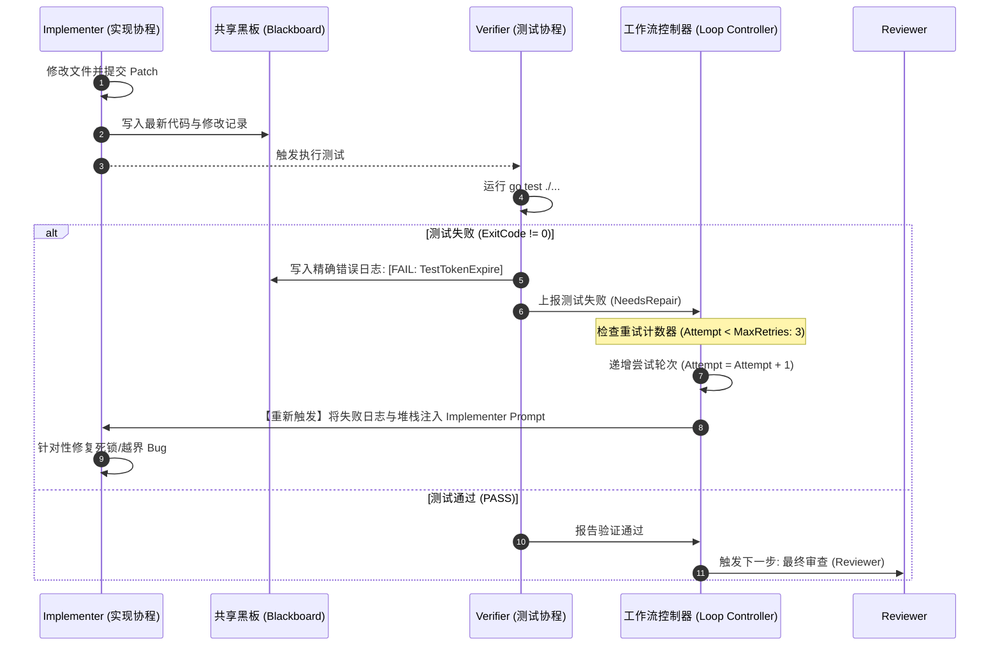
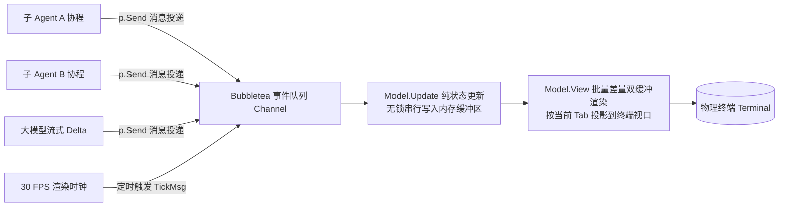

# Go语言高性能通用Coding-Agent-Harness技术方案

> [!abstract] 核心设计目标一览
> 本方案旨在基于 Go 语言构建一款**参考 Pi 架构、原生支持 Goroutine 协程级轻量子 Agent、高度模块化且具备极强扩展性**的现代化 AI Coding Agent Harness（暂定代号：`gopi`）。
> 彻底解决传统 Node.js/Python Harness 在多 Agent 协作时“一 Agent 一进程导致内存飙升（50MB~100MB/个）、冷启动延迟高、IPC 频繁序列化”的核心痛点，实现**单 Agent 内存开销 < 1MB、冷启动 < 1ms、全局 Token 桶调度、支持嵌入式 JS/Wasm 动态扩展**的企业级基础设施。

---

## 一、方案概览与背景分析

### 1.1 需求背景与痛点

随着复杂软件工程任务对 Multi-Agent（如 Scout $\rightarrow$ Planner $\rightarrow$ Implementer $\rightarrow$ Verifier $\rightarrow$ Reviewer 协作流水线）的依赖加深，现存主流 Harness（包括 Claude Code、Pi CLI 原生实现等）普遍采用 `child_process.spawn("pi", [...])` 的进程级派生方案：

1. **资源吞吐瓶颈**：每个 Node.js V8 运行时初始化开销巨大，5~8 个并发子 Agent 瞬间吞噬近 1GB 内存，多核 CPU 频繁陷入上下文切换。
2. **冷启动与延迟**：子进程需要重复加载配置、解析模块、建立连接，启动耗时高达 500ms~1500ms。
3. **资源失控与 API 踩踏**：跨进程缺乏中心化的全局并发度与 Token 速率（RPM/TPM）仲裁器，并发子 Agent 极易触发大模型 API 429 报错。
4. **进程残留与死锁**：父进程异常或提前终止时，难以做到毫秒级树状级联杀进程，偶发僵尸进程占用文件锁。

### 1.2 目标定位
- **语言底座**：纯 Go（Go 1.22+），单一静态编译二进制，零外部动态依赖，极速分发。
- **并发性能**：子 Agent 为纯粹的 **Goroutine（协程）**，单 Agent 运行时内存 < 1MB，启动耗时 < 1ms。
- **协议兼容**：完全对齐 Pi 的 4 种运行模式（TUI 交互、Print 单次直出、JSONL 事件流、RPC 长连接）与 MCP（Model Context Protocol）生态。
- **扩展能力**：支持 Go 原生编译级插件、嵌入式脚本引擎（Goja 支持动态 JS 扩展）、Wasm 沙箱工具扩展。

---

## 二、系统总体架构设计

### 2.1 分层架构拓扑图



---

## 三、核心模块详细技术设计

### 3.1 模块一：Goroutine 级子 Agent 调度中心（Resource Governor）

为了保证数百个子 Agent 协程并发时不打崩网络、不超出系统限制，设计两级调度器：



#### 核心代码结构设计
```go
package scheduler

import (
	"context"
	"golang.org/x/sync/semaphore"
	"golang.org/x/time/rate"
)

// Governor 全局资源控制器
type Governor struct {
	concurrencySem *semaphore.Weighted // 并发度信号量
	tokenLimiter   *rate.Limiter       // TPM (Token Per Minute) 限制器
	requestLimiter *rate.Limiter       // RPM (Request Per Minute) 限制器
}

func NewGovernor(maxConcurrency int64, rpm, tpm int) *Governor {
	return &Governor{
		concurrencySem: semaphore.NewWeighted(maxConcurrency),
		tokenLimiter:   rate.NewLimiter(rate.Limit(tpm/60), tpm),
		requestLimiter: rate.NewLimiter(rate.Limit(rpm/60), rpm),
	}
}

// ExecuteSubagent 调度协程运行子 Agent
func (g *Governor) ExecuteSubagent(ctx context.Context, fn func(ctx context.Context) error) error {
	// 1. 获取并发槽位
	if err := g.concurrencySem.Acquire(ctx, 1); err != nil {
		return err // 上下文取消或超时
	}
	defer g.concurrencySem.Release(1)

	// 2. 限流等待
	if err := g.requestLimiter.Wait(ctx); err != nil {
		return err
	}

	// 3. 执行协程逻辑
	return fn(ctx)
}
```

---

### 3.2 模块二：工具系统（Tooling & Context-Scoped Execution）

解决多协程 Agent **不能使用全局 `process.chdir()`** 的核心技术难点。所有工具强制基于上下文参数解析路径：

```go
package tool

import (
	"context"
	"encoding/json"
)

// ToolContext 工具执行上下文（完全隔离）
type ToolContext struct {
	context.Context
	Cwd           string            // 该 Agent 绑定的隔离工作目录
	Environment   map[string]string // 专属环境变量
	AllowedPaths  []string          // 允许读写的安全路径白名单
	EventChan     chan<- ToolEvent  // 工具执行进度通知
}

// Tool 工具核心接口
type Tool interface {
	Name() string
	Description() string
	InputSchema() json.RawMessage // JSON Schema 定义
	Execute(ctx *ToolContext, args json.RawMessage) (*ToolResult, error)
}

// ToolResult 返回结构
type ToolResult struct {
	Content string `json:"content"`
	IsError bool   `json:"is_error"`
	Details any    `json:"details,omitempty"`
}
```

- **内置工具集**：
  - `read`：支持 `offset` / `limit` 范围读取，大文件流式截断（50KB / 2000行）。
  - `edit`：高精度精确文本替换，带严格唯一性校验（防止误修改同名代码块）。
  - `write`：原子性写入，先写临时文件后 `os.Rename`。
  - `bash`：通过 `exec.CommandContext(ctx, ...)` 执行，支持超时强杀、标准流实时截获。
  - `grep` / `find`：集成高性能纯 Go 实现（或调用 `ripgrep` 二进制）。

---

### 3.3 模块三：模型运行时抽象与流式通信（Model Runtime）

统一不同 LLM 厂商的流式适配，采用统一的 Go Channel 流式传递：

```go
package model

import (
	"context"
	"io"
)

type ChatMessage struct {
	Role    string     `json:"role"`
	Content string     `json:"content"`
	ToolCalls []ToolCall `json:"tool_calls,omitempty"`
}

type ModelStreamChunk struct {
	DeltaText    string
	ToolCallDelta *ToolCallDelta
	FinishReason string
	Usage        *TokenUsage
	Error        error
}

type Provider interface {
	Name() string
	StreamChat(ctx context.Context, req *ChatRequest) (<-chan ModelStreamChunk, error)
}
```

支持的驱动适配器：
1. **OpenAI 兼容协议**（OpenAI, DeepSeek, Moonshot, Qwen, vLLM 等）
2. **Anthropic 协议**（Claude 3.5 / 3.7，支持 `thinking` 思考块捕获）
3. **Google Gemini 原生 API**
4. **Ollama 本地大模型**

---

### 3.4 模块四：会话管理与事件总线（Session & EventBus）

#### 1. 内存会话与持久化会话双模式
- **持久化会话（Persistent Session）**：用于 CLI 交互模式，将消息追加到 `~/.gopi/sessions/--path--/session.jsonl`，完全复刻 Pi 的 Branching 逻辑。
- **纯内存会话（In-Memory Session）**：**子 Agent 默认启用**。所有消息保存在内存 slice 中，任务结束随闭包自动被 Go GC 回收，磁盘零 I/O 损耗。

#### 2. Channel-based EventBus
```go
type AgentEventType string

const (
	EventAgentStart    AgentEventType = "agent_start"
	EventMessageUpdate AgentEventType = "message_update"
	EventToolCall      AgentEventType = "tool_call"
	EventToolResult    AgentEventType = "tool_result"
	EventMessageEnd    AgentEventType = "message_end"
	EventAgentSettled  AgentEventType = "agent_settled"
)

type AgentEvent struct {
	Type      AgentEventType `json:"type"`
	Timestamp int64          `json:"timestamp"`
	Payload   any            `json:"payload"`
}
```

---

### 3.5 模块五：动态扩展机制（Extension Engine）

为了实现像 Pi 一样不重新编译源码就能挂载扩展，方案设计了三层扩展架构：



1. **JavaScript 脚本沙箱（基于 `dop251/goja`）**：
   - 在 Go 内部直接运行 JS 脚本；
   - 暴露 `pi.registerTool(...)`、`pi.on(...)` API 给 JS；
   - 用户编写的一个 `my-tool.js` 扩展，可以直接在 `gopi` 中无需编译即插即用！
2. **Skills 体系**：
   - 完全兼容现有 `SKILL.md` 规范；
   - 自动扫描用户目录与项目目录下的 YAML Frontmatter 描述，按需激活加载到系统提示词中。

---

### 3.6 核心机制：外部 LLM 如何自动触发调用子 Agent 协程

> [!question] 核心疑问
> 协程是 Go 语言底层的代码实现，外部大模型（LLM）作为一个只会吐字和 JSON 的模型，**如何自动感知并触发 Go 协程的启动、调度与结果回收？**

#### 1. 核心映射桥梁：Meta-Tool Calling（元工具调用协议）

外部 LLM 无法直接执行 Go 关键字，它触发协程的唯一通道是：**LLM Function Calling 协议 + Go 运行时的动态分发器（Meta-Tool Dispatcher）**。



#### 2. 第一步：向主 LLM 声明 `subagent` 工具元数据

主 Agent 初始化时，Go Harness 在工具列表注入 `subagent` 的 JSON Schema，提示 LLM 可以将复杂子任务交由专业工种执行：

```json
{
  "name": "subagent",
  "description": "当任务复杂、需要并行分析或需要专业角色（如侦查架构、审查代码、编写测试）时调用。系统将为你并发启动多个轻量子 Agent 执行任务并汇总返回。",
  "parameters": {
    "type": "object",
    "properties": {
      "tasks": {
        "type": "array",
        "items": {
          "type": "object",
          "properties": {
            "agent": {
              "type": "string",
              "enum": ["scout", "planner", "implementer", "verifier", "reviewer"],
              "description": "专业工种名称"
            },
            "task": {
              "type": "string",
              "description": "具体指派给该子 Agent 的明确任务描述"
            }
          },
          "required": ["agent", "task"]
        }
      }
    },
    "required": ["tasks"]
  }
}
```

#### 3. 第二步：Go 引擎拦截并就地起协程（Goroutine Dispatch）

Go 的 Tool 执行器收到 `subagent` 的调用请求后，利用 `errgroup` 动态为 `tasks` 中的每一项起一个 Goroutine，完全在同一进程内实现内存与上下文隔离：

```go
package agent

import (
	"context"
	"encoding/json"
	"fmt"
	"golang.org/x/sync/errgroup"
)

type SubagentArgs struct {
	Tasks []struct {
		Agent string `json:"agent"`
		Task  string `json:"task"`
	} `json:"tasks"`
}

type SubagentTool struct {
	governor *Governor // 资源调度器 (控制并发信号量与Token桶)
}

func (t *SubagentTool) Name() string { return "subagent" }

func (t *SubagentTool) Execute(ctx *ToolContext, rawArgs json.RawMessage) (*ToolResult, error) {
	var args SubagentArgs
	if err := json.Unmarshal(rawArgs, &args); err != nil {
		return &ToolResult{IsError: true, Content: "参数解析失败: " + err.Error()}, nil
	}

	results := make([]string, len(args.Tasks))
	g, subCtx := errgroup.WithContext(ctx)

	// 核心：根据 LLM 传来的 tasks 动态创建 Go 协程！
	for i, item := range args.Tasks {
		idx := i
		targetAgent := item.Agent
		targetTask := item.Task

		g.Go(func() error {
			// 通过 Governor 获取并发槽位与 Token 桶排队
			return t.governor.ExecuteSubagent(subCtx, func(c context.Context) error {
				// 1. 创建纯内存隔离 Session（单个内存 < 1MB，零磁盘 I/O）
				subSession := NewInMemorySession(targetAgent)
				
				// 2. 根据工种自动裁剪工具权限（如 scout 仅限 read/find/grep）
				subSession.SetTools(ResolveToolsForRole(targetAgent))
				
				// 3. 执行子 Agent 推理闭环
				res, err := subSession.Run(c, targetTask)
				if err != nil {
					results[idx] = fmt.Sprintf("[%s 执行失败]: %v", targetAgent, err)
					return nil // 容错处理，不中断其他并行协程
				}
				results[idx] = fmt.Sprintf("【%s 汇报】:\n%s", targetAgent, res)
				return nil
			})
		})
	}

	// 等待所有子 Agent 协程全部执行完毕
	if err := g.Wait(); err != nil {
		return &ToolResult{IsError: true, Content: "子任务执行异常: " + err.Error()}, nil
	}

	// 汇总所有协程的产出，组装为单个 ToolResult 回填主 LLM
	finalOutput := "子 Agent 并行执行完毕，汇总结果如下：\n\n"
	for _, r := range results {
		finalOutput += r + "\n---\n"
	}

	return &ToolResult{IsError: false, Content: finalOutput}, nil
}
```

#### 4. 第三步：实时进度穿透冒泡（Channel-based Streaming UI）

子协程在后台执行读取文件、分析代码时，通过 Go `chan AgentEvent` 将自身动作实时上报给主进程事件总线，终端 TUI 即可并行刷新子进度：

```go
// 子协程执行工具时向主事件总线广播
subSession.OnToolCall = func(toolName string, args string) {
    ctx.EventChan <- AgentEvent{
        Type: "subagent_progress",
        Payload: fmt.Sprintf("[%s] 正在执行 %s ...", targetAgent, toolName),
    }
}
```

终端 TUI 即可同时呈现多条并行微任务流：
```text
⠋ [scout] 正在检索 src/auth/token.go (行 1~120)...
⠋ [reviewer] 正在分析 git commit 差异...
```

#### 5. 两种业务触发模式对比

- **模式 A：LLM 自主决策派生（Dynamic ReAct）**：主 LLM 根据自身推理，自主决定何时调用 `subagent`、调用几个、分配什么工种。适用于开放式需求与通用调试。
- **模式 B：确定性状态机工作流（Deterministic Orchestrator）**：由 Go 业务代码显式固化流程（如 `Scout` $\rightarrow$ `Planner` $\rightarrow$ `Implementer` $\rightarrow$ `Verifier`），每一步由 Go 调度器直接驱动 Goroutine，LLM 仅在限定提示词下产出结果。适用于工业级规范的代码重构、漏洞修复与自动化发布。

---

### 3.7 核心机制：Agent 状态机与上下文生命周期管理（State Management Deep Dive）

> [!abstract] 状态管理中枢
> 在高并发多协程环境下，Agent 的状态管理不仅包括简单的“空闲/忙碌”，还必须精确管理**流式输出中断、工具执行回执、人机确认挂起、用户中途插话（Steering）、上下文分支树（Branching）与超长压缩（Compaction）**。

#### 1. Agent 完整生命周期状态机



#### 2. 基于 Actor 模型（单协程写循环）的无锁状态管理架构

在 Go 多协程（主 Agent、子 Agent、TUI 渲染、RPC 监听器）高并发读写状态时，如果滥用 `sync.RWMutex`，极易因锁粒度设计不当导致死锁。

**最佳实践架构：每个 Agent 实例内部常驻一个独立的 `agentLoop` 事件驱动协程（Actor 模式）**。所有对状态的修改请求（追加消息、流式 Delta、Tool 回执、Abort 信号、插话信号）全部通过私有 Channel 发送给该 Loop 串行写，外部读取则获取**不可变状态快照（Immutable Snapshot）**，彻底消除锁竞争：

```go
package agent

import (
	"context"
	"sync/atomic"
)

// AgentStatus 状态机枚举
type AgentStatus string

const (
	StatusIdle            AgentStatus = "idle"
	StatusPrompting       AgentStatus = "prompt_processing"
	StatusStreaming       AgentStatus = "streaming_model_response"
	StatusToolExecuting   AgentStatus = "tool_executing"
	StatusAwaitingApproval AgentStatus = "awaiting_approval"
	StatusCompacting      AgentStatus = "compacting"
	StatusSettled         AgentStatus = "settled"
	StatusDisposed        AgentStatus = "disposed"
)

// ActionCommand 状态变更指令 (通过 Channel 发送给 Loop 串行处理)
type ActionCommand interface {
	isAction()
}

type CmdUserPrompt struct{ Text string }
type CmdStreamDelta struct{ Text string }
type CmdToolStart struct{ ToolName string; Args string }
type CmdToolResult struct{ ToolName string; Output string }
type CmdSteer struct{ Text string }
type CmdAbort struct{}

// AgentStateSnapshot 供外部 (TUI/RPC) 只读的不可变快照
type AgentStateSnapshot struct {
	Status        AgentStatus
	ActiveBranch  []Message
	ActiveTool    string
	ContextTokens int64
	TurnCount     int
}

type AgentInstance struct {
	status      atomic.Pointer[AgentStatus]
	cmdChan     chan ActionCommand
	eventBus    *EventBus
	sessionTree *SessionTree
}

// 核心：单协程驱动状态机跃迁 (Actor Event Loop)
func (a *AgentInstance) agentLoop(ctx context.Context) {
	for {
		select {
		case <-ctx.Done():
			a.transition(StatusDisposed)
			return
		case cmd := <-a.cmdChan:
			switch c := cmd.(type) {
			case CmdUserPrompt:
				a.transition(StatusPrompting)
				a.sessionTree.AppendUserMessage(c.Text)
				a.triggerModelInference(ctx)

			case CmdStreamDelta:
				a.transition(StatusStreaming)
				a.sessionTree.AppendAssistantDelta(c.Text)

			case CmdToolStart:
				a.transition(StatusToolExecuting)
				a.eventBus.Publish(EventToolCall, c.ToolName)

			case CmdToolResult:
				a.sessionTree.AppendToolResult(c.ToolName, c.Output)
				// 检查上下文是否超限，超限则跃迁至 Compacting，否则继续推理
				if a.shouldCompact() {
					a.transition(StatusCompacting)
					a.compactContext()
				}
				a.transition(StatusStreaming)
				a.triggerModelInference(ctx)

			case CmdSteer:
				// 用户插话：强行截断当前后续工具，插入纠偏消息
				a.sessionTree.AppendSteeringMessage(c.Text)
				a.transition(StatusPrompting)
				a.triggerModelInference(ctx)

			case CmdAbort:
				a.transition(StatusSettled)
			}
		}
	}
}

func (a *AgentInstance) transition(next AgentStatus) {
	a.status.Store(&next)
	a.eventBus.Publish("status_changed", next)
}
```

#### 3. 会话分支树（Session Entry Tree & Branching）不可变设计

为了支持“撤销上一步（Undo）”、“重新生成（Retry）”和“分支探查”，会话记录不是简单的线性数组，而是一棵**以唯一哈希为节点的 Entry 树**：



- **数据结构定义**：
  ```go
  type SessionEntry struct {
      ID        string          `json:"id"`
      ParentID  string          `json:"parent_id"` // 指向父节点，构成树结构
      Timestamp int64           `json:"timestamp"`
      Type      string          `json:"type"`      // "message", "compaction", "custom"
      Payload   json.RawMessage `json:"payload"`
  }
  ```
- **线性上下文投影算法**：
  大模型只接受一维消息列表。当需要请求 LLM 时，状态机根据当前的 `activeLeafID`，**自底向上遍历 `ParentID` 链条直到根节点**，再将切片逆序反转，瞬间重构出当前分支的线性 Prompt 历史。
- **子 Agent 的影子树挂载**：
  子 Agent 在内存中运行独立分支树，其内部的多轮思考与文件试错不进入主分支，任务完成后仅将一条精简的 `SubagentResultEntry` 作为单一节点挂在主树叶子上，既保留了因果链，又避免了主会话上下文爆炸。

#### 4. 动态交互状态：转向（Steering）与排队（Follow-up）

用户在终端输入时，状态机根据当前运行阶段提供细分处理：

| 机制                   | 触发场景                             | 状态机动作                                   | 上下文效果                                                     |
| :------------------- | :------------------------------- | :-------------------------------------- | :-------------------------------------------------------- |
| **转向 (Steer)**       | 模型正在生成错误方案，或正在执行不符合预期的工具调用       | 发送 `CmdSteer`，立即取消未执行的 ToolCall，中止当前模型流 | 在当前 Assistant 消息截断处下方立即追加一条 `User: (转向指导)`，迫使模型在下一轮反思重走逻辑 |
| **后续排队 (Follow-up)** | 模型正在有条不紊地工作，用户想交代“等这做完再帮我加个单元测试” | 将新指令压入 `followUpQueue` 队列，状态机保持原状态推进    | 待当前轮次工具闭环完毕且状态跃迁至 `Settled` 时，自动弹出队列首项作为新输入启动下一轮          |

#### 5. 智能上下文压缩状态管理（Context Compaction）

当会话经历多轮工具调用后，`ContextTokens` 会逼近模型上限（如达到 80% 窗口阈值）：

1. **跃迁到 `Compacting` 状态**：挂起常规模型请求；
2. **三段式裁剪策略**：
   - **保留头部**：系统提示词（System Prompt）和用户初始目标绝对保留；
   - **折叠中间**：将早期多轮工具执行过程（例如长达数千行的 `read` 或 `compile` 输出）进行语义折叠，替换为结构化摘要：`<compacted: read 15 files, compiled successfully with 2 warnings>`；
   - **保留尾部**：完整保留最近两轮的真实对话细节，维持上下文连贯性；
3. **写入 `CompactionEntry` 节点**：在分支树中落下一个特殊的压缩标记，完成状态机重置，随后平滑跃迁回 `StreamingModelResponse` 继续执行。

#### 6. 人机协同确认状态（Awaiting Approval）

为防止 Agent 执行破坏性操作（如调用高危命令 `rm -rf`、覆盖受保护的配置），工具执行器与状态机深度联动：

```go
func (t *BashTool) Execute(ctx *ToolContext, rawArgs json.RawMessage) (*ToolResult, error) {
    if isDangerousCommand(rawArgs) {
        // 1. 状态机跃迁到等待审批
        ctx.Agent.Transition(StatusAwaitingApproval)
        
        // 2. 阻塞等待用户在 TUI 或 RPC 管道确认
        approved := ctx.Agent.RequestUserApproval("执行高危命令: " + string(rawArgs))
        if !approved {
            ctx.Agent.Transition(StatusToolExecuting)
            return &ToolResult{IsError: true, Content: "用户已拒绝执行该命令"}, nil
        }
    }
    
    // 3. 用户批准，恢复执行
    ctx.Agent.Transition(StatusToolExecuting)
    return executeCommand(ctx, rawArgs)
}
```

---

### 3.8 核心机制：Multi-Agent 相互通信与依赖触发体系（Inter-Agent Communication & DAG Triggering）

> [!abstract] 多 Agent 协作之魂
> 多个 Agent 如果各自为政，只是孤立的工具；只有具备**相互通信（Communication）**与**依赖触发（Dependency Triggering）**，才能真正形成紧密协同的软件工程装配流水线。

#### 1. Agent 间相互通信的三大拓扑模型

在 Go 语言单进程多协程体系下，我们提供三种互补的通信拓扑：



| 通信模式 | 实现机制 (Go 原语) | 核心解决问题 | 典型应用场景 |
| :--- | :--- | :--- | :--- |
| **共享黑板 (Blackboard)** | 线程安全 `sync.Map` / 结构体 + 键级读写锁 | **避免网状传递**：大体量事实数据（如扫描出的 100 个文件、架构蓝图）无需在 Agent 间逐层拷贝 | Scout 沉淀事实资产，供后续所有工种随时随地按需索引 |
| **A2A 工具化信箱 (Actor Mailbox)** | 每个 Agent 独立 `chan AgentMessage` + A2A 专属工具 | **跨工种即时答疑**：执行者写代码遇到疑惑，无需退出任务，直接向侦查员请教 | Implementer 写代码中途调用 `ask_agent("scout", "AuthToken 的有效期在哪定义？")` |
| **事件广播 (Pub/Sub EventBus)** | Go 原生 Channel 广播 | **解耦事件通知**：某一阶段完成或失败时，通知相关监听方，无直接代码耦合 | 测试完成广播、代码变更通知、用户插话取消广播 |

---

#### 2. 依赖触发引擎：有向无环图（DAG）调度实现

工程流水线中最常见的模式是**前置任务完成后自动触发后置任务**，且支持**分支并行（Fan-Out）与栅栏合并（Fan-In / Barrier）**：



#### Go 原生 DAG 依赖触发器核心实现：
```go
package workflow

import (
	"context"
	"fmt"
	"sync"
	"sync/atomic"
)

// TaskNode DAG 任务节点
type TaskNode struct {
	ID         string
	AgentRole  string
	TaskPrompt string
	DependsOn  []string // 依赖的前置节点 ID 列表
	
	inDegree   int32    // 剩余前置依赖计数
	doneChan   chan struct{}
	output     string
	err        error
}

// DAGScheduler 依赖触发调度引擎
type DAGScheduler struct {
	nodes    map[string]*TaskNode
	blackboard *Blackboard
	governor   *Governor
}

func NewDAGScheduler(nodes []*TaskNode, bb *Blackboard, gov *Governor) *DAGScheduler {
	nodeMap := make(map[string]*TaskNode)
	for _, n := range nodes {
		n.doneChan = make(chan struct{})
		n.inDegree = int32(len(n.DependsOn))
		nodeMap[n.ID] = n
	}
	return &DAGScheduler{nodes: nodeMap, blackboard: bb, governor: gov}
}

// Execute 自动依据依赖拓扑，最大化并发触发 Goroutine
func (s *DAGScheduler) Execute(ctx context.Context) error {
	var wg sync.WaitGroup

	for _, node := range s.nodes {
		wg.Add(1)
		
		// 为每个节点启动一个监听守卫协程
		go func(n *TaskNode) {
			defer wg.Done()

			// 1. 等待所有前置依赖节点完成
			for _, depID := range n.DependsOn {
				depNode := s.nodes[depID]
				select {
				case <-ctx.Done():
					n.err = ctx.Err()
					close(n.doneChan)
					return
				case <-depNode.doneChan:
					if depNode.err != nil {
						n.err = fmt.Errorf("前置依赖 %s 失败: %w", depID, depNode.err)
						close(n.doneChan)
						return
					}
				}
			}

			// 2. 前置依赖全部就绪，通过资源调度器并发执行当前 Agent 协程！
			err := s.governor.ExecuteSubagent(ctx, func(c context.Context) error {
				// 从黑板中拉取前置依赖沉淀的数据，拼装上下文
				mergedContext := s.blackboard.BuildInputForTask(n.DependsOn)
				
				agentSession := NewInMemorySession(n.AgentRole)
				agentSession.AppendSystemPrompt(mergedContext)
				
				res, runErr := agentSession.Run(c, n.TaskPrompt)
				if runErr != nil {
					return runErr
				}
				
				n.output = res
				// 将本节点的产出写入共享黑板，供后置节点消费
				s.blackboard.Set(n.ID, res)
				return nil
			})

			n.err = err
			// 3. 关闭当前 doneChan，瞬间触发下游依赖它的所有后置节点！
			close(n.doneChan)
		}(node)
	}

	wg.Wait()
	return nil
}
```

---

#### 3. 动态自愈与修复回路（Repair Loop via Conditional Edge）

在真实的编码场景中，依赖关系绝非简单的单向直通，**最核心的工业级能力是：根据 Verifier 的执行结果实现“条件回退与自我修复”**。



- **防死循环熔断机制**：
  在回退流转中，工作流控制器内置 `AttemptCounter`。一旦连续修复 **2 次（两轮原则）或 3 次** 仍未通过测试，系统立即执行**熔断保护（Fail-Fast）**：
  1. 自动执行 `git checkout` 还原所有污染代码；
  2. 终止自动修复闭环，整理当前排查出的真实阻碍与事实链条；
  3. 跃迁至 `AwaitingApproval` 状态，将阻碍报告呈现给用户，请求人类介入决策。

---

#### 4. A2A（Agent-to-Agent）点对点即时问答实现

除了 DAG 编排，大模型在编写代码时往往产生**不可预测的局部疑问**。我们通过在子 Agent 的工具箱中动态注入 `ask_peer_agent` 工具，赋予其点对点会话能力：

```go
// AskPeerTool 允许 Agent 之间直接进行 RPC 式的点对点问答
type AskPeerTool struct {
	router *AgentMessageRouter
}

func (t *AskPeerTool) Name() string { return "ask_peer_agent" }

func (t *AskPeerTool) Execute(ctx *ToolContext, rawArgs json.RawMessage) (*ToolResult, error) {
	var args struct {
		TargetRole string `json:"target_role"` // 如 "scout"
		Question   string `json:"question"`    // 如 "请帮我查一下 UserService 接口里定义了哪些方法？"
	}
	if err := json.Unmarshal(rawArgs, &args); err != nil {
		return &ToolResult{IsError: true, Content: err.Error()}, nil
	}

	// 1. 通过内部路由器直接将提问派发给对应的专业 Agent 协程
	// 2. 目标 Agent 在自己独立的只读环境中执行快查并生成精准解答
	answer, err := t.router.DispatchDirectQuery(ctx, args.TargetRole, args.Question)
	if err != nil {
		return &ToolResult{IsError: true, Content: "对端 Agent 响应异常: " + err.Error()}, nil
	}

	// 3. 将解答直接作为 ToolResult 返回给提问方，提问方 Agent 无缝继续写代码！
	return &ToolResult{
		IsError: false,
		Content: fmt.Sprintf("[%s 的回答]: %s", args.TargetRole, answer),
	}, nil
}
```

---

### 3.9 核心机制：TUI 交互架构与多 Agent 动态渲染引擎（TUI Visualization & Multi-Agent UI Engine）

> [!abstract] 终端多任务可视化痛点
> 传统 CLI 的简单滚动输出在单 Agent 场景尚可应对，但在多 Agent 并发协作时会彻底崩塌：
> 1. **文本撕裂混乱（Interleaved Logs）**：多个子 Agent 协程并发写 stdout，导致各角色的思考、报错、工具输出交织成乱码；
> 2. **终端高频闪烁（Terminal Flickering）**：多路 LLM 达到每秒数百 token 的流式刷新率，高频无节制刷新造成屏幕剧烈闪烁；
> 3. **宏观全局与微观细节无法兼顾**：用户既想看“整个工作流推进到了哪一步”，又想下钻细看“某一个子 Agent 正在读写哪个文件”。

#### 1. 终端四象限视口蓝图（Terminal Viewport Blueprint）

基于 `charmbracelet/lipgloss` 与 `bubbles` 构建自适应全屏终端分层布局：

```text
┌────────────────────────────────────────────────────────────────────────────────────────┐
│  gopi v1.0.0 │ Model: claude-3-7-sonnet:high │ Session: 01a1c9bf │ Tokens: 42.8k (↑38k) │
├────────────────────────────────────────────────────────────────────────────────────────┤
│ [1: 总体工作流 (Workflow)]  [2: Scout 侦查]  [3: Implementer 编码]  [4: Reviewer 审查]  │
├──────────────────────────────────────────────────────┬─────────────────────────────────┤
│ ▾ [Bugfix Workflow: 修复鉴权超时死锁] (4.6s)         │ [聚焦视图: Implementer 协程]     │
│   ├─ ✓ Scout (发现 3 个关键文件)              [DONE] │                                 │
│   ├─ ▾ ⠋ Planner (重构方案制定中...)       [RUNNING] │ 正在应用精准代码补丁:           │
│   │   ├─ ⠋ Impl-Backend (auth_token.go)     [RUNNING] │ ```diff                         │
│   │   └─ ⏸ Impl-Frontend (等待后端就绪)     [BLOCKED] │ -  mu.Lock()                    │
│   ├─ ⏸ Verifier (集成测试)                  [WAITING] │ +  if !mu.TryLock() {           │
│   └─ ⏸ Reviewer (代码最终审查)              [WAITING] │ +      return ErrBusy           │
│                                                      │ ```                             │
│                                                      │ ⠋ 正在运行语法检查 (gopls)...   │
├──────────────────────────────────────────────────────┴─────────────────────────────────┤
│  ⚡ 动态任务泳道 (Active Coroutine Tray):                                               │
│  ⠋ [Scout]       reading internal/auth/jwt.go (line 40~120)...                   1.4s  │
│  ⠙ [Impl-Backend] generating patch for mutex deadlocks...                        2.1s  │
├────────────────────────────────────────────────────────────────────────────────────────┤
│ > 请帮我重构 auth 模块，并消除并发锁竞争...                                            │
│ [Enter: 发送 | Tab: 切换 Agent 选项卡 | Ctrl+C: 取消 | Space: 暂停流式 | Esc: 返回主视图]│
└────────────────────────────────────────────────────────────────────────────────────────┘
```

---

#### 2. 底层架构：基于 Bubbletea (TEA) 的统一单向数据流

严禁任何后台 Goroutine 直接向 `os.Stdout` 输出字符！所有后台事件必须统一转化为标准消息投递至 TUI 事件循环：



#### 核心优势：
- **绝对线程安全（Zero Race Conditions）**：所有状态变更均收敛在 Bubbletea 的 `Update(msg)` 单协程循环中处理；
- **双缓冲防闪烁（Zero Flicker via FPS Throttling）**：即便后台每秒收到 1000 个 Token Delta，TUI 仅根据 30 FPS（每 33ms 一次）的节流时钟批量触发重绘，兼顾毫秒级丝滑与极低 CPU 占用。

---

#### 3. 核心机制：独立虚拟屏幕缓冲区（Per-Agent Virtual Buffer）

TUI 模型内部为每个 Agent 维护独立的视口缓冲区，彻底解决文本交织：

```go
package tui

import (
	"github.com/charmbracelet/bubbles/viewport"
	tea "github.com/charmbracelet/bubbletea"
	"github.com/charmbracelet/lipgloss"
)

// AgentViewBuffer 单个 Agent 专属的虚拟屏幕缓冲
type AgentViewBuffer struct {
	AgentID       string
	RoleName      string
	Status        string // RUNNING, DONE, FAILED, BLOCKED
	Viewport      viewport.Model
	RawTextBuffer string
	ActiveTool    string
	ElapsedTime   string
}

// MainUIModel 全局终端界面状态模型
type MainUIModel struct {
	activeTabID   string                      // 当前处于焦点的前台 Agent ID ("main", "scout", "impl")
	agentBuffers  map[string]*AgentViewBuffer // 各子 Agent 虚拟缓冲池 (相互隔离)
	workflowTree  *WorkflowTreeModel          // 左侧 DAG 树组件
	inputArea     viewport.Model              // 底部输入框
	width, height int
}

// Init 启动全局渲染节流时钟 (30 FPS)
func (m MainUIModel) Init() tea.Cmd {
	return tea.Batch(
		tea.EnterAltScreen, // 开启全屏备用屏幕
		tickEvery(33),      // 30 FPS 防闪烁时钟
	)
}

// Update 处理来自各个子协程的异步消息
func (m MainUIModel) Update(msg tea.Msg) (tea.Model, tea.Cmd) {
	switch msg := msg.(type) {
	case tea.KeyMsg:
		switch msg.String() {
		case "tab":
			// Tab 键平滑循环切换聚焦的子 Agent 选项卡
			m.cycleNextActiveTab()
			return m, nil
		case "ctrl+c":
			return m, tea.Quit
		}

	// 收到某个子 Agent 的流式 Token
	case AgentStreamDeltaMsg:
		buf, exists := m.agentBuffers[msg.AgentID]
		if exists {
			buf.RawTextBuffer += msg.DeltaText
			buf.Viewport.SetContent(buf.RawTextBuffer)
			buf.Viewport.GotoBottom() // 自动保持滚动到底部
		}
		return m, nil

	// 收到某个子 Agent 状态跃迁通知 (如进入工具调用)
	case AgentStatusChangedMsg:
		if buf, exists := m.agentBuffers[msg.AgentID]; exists {
			buf.Status = msg.NewStatus
			buf.ActiveTool = msg.ToolName
		}
		m.workflowTree.UpdateNodeStatus(msg.AgentID, msg.NewStatus)
		return m, nil

	case TickMsg:
		// 30 FPS 刷新动画 (如 Spinner 旋转)
		return m, tickEvery(33)
	}

	return m, nil
}

// View 双缓冲批量渲染
func (m MainUIModel) View() string {
	// 1. 渲染 Header
	header := m.renderHeader()
	// 2. 渲染 Tabs 栏
	tabs := m.renderTabBar()
	// 3. 渲染主工作区分栏 (左侧 DAG 依赖树 35% 宽 + 右侧当前活跃 Agent 缓冲视口 65% 宽)
	mainBody := lipgloss.JoinHorizontal(
		lipgloss.Top,
		m.workflowTree.Render(m.width*35/100, m.height-10),
		m.agentBuffers[m.activeTabID].Viewport.View(),
	)
	// 4. 渲染底部动态任务泳道 (Active Coroutine Tray)
	tray := m.renderActiveSubagentsTray()
	// 5. 渲染用户输入框
	footer := m.renderFooter()

	return lipgloss.JoinVertical(lipgloss.Left, header, tabs, mainBody, tray, footer)
}
```

---

#### 4. 视觉状态徽标与多任务动态泳道（Status Tray）

针对复杂的依赖状态，界面采用鲜明的 Lipgloss 风格徽标：

| 状态 | 徽标样式与色系 (ANSI 256) | 动态效果 | 交互含义 |
| :--- | :--- | :--- | :--- |
| **执行中** | `⠋ [RUNNING]` (青色 Cyan) | 逐帧平滑 Spinner 旋转 | 正在与大模型通信或读写本地文件 |
| **依赖阻塞** | `⏸ [BLOCKED]` (灰色 Muted) | 静态暗淡显示 | 前置依赖尚未结束，处于 Goroutine 挂起就绪队列 |
| **完成通过** | `✓ [DONE]` (鲜绿 Green) | 静态常亮，显示总耗时 | 本阶段任务顺利闭环 |
| **自愈修复** | `↻ [REPAIR: 1/3]` (亮黄 Yellow) | 闪烁提示 | 单元测试失败，正将错误堆栈注入 Implementer 重新修复 |
| **等待审批** | `⚠ [APPROVAL REQUIRED]` (品红 Magenta) | 边框跳动高亮 | 触发高危命令，终端焦点强制锁定在审批确认框 |
| **异常失败** | `✗ [FAILED]` (红色 Red) | 警示色 | 达到最大重试上限，终止流程转交人工 |

- **多任务动态泳道（Active Tray）交互设计**：
  在屏幕倒数 3~4 行固定保留一个“正在运行中的子协程摘要栏”，即使前台正在主会话打字，也能一目了然看到后台有几个 Agent 在并行开工、各自耗时多久。用户只需轻轻按下快捷键 `Alt + 2` 或点击鼠标，即可瞬间将视口无缝下钻到对应子协程的内部现场！

---

## 四、模式对齐与 CLI 接口设计

完全对齐 Pi 的标准 CLI 行为：

```bash
# 1. 交互模式 (基于 Charmbracelet Bubbletea 打造全屏 TUI)
gopi

# 2. 管道输出模式 (单次运行退出)
gopi -p "分析这行代码"

# 3. 结构化 JSONL 事件流 (供外部系统集成)
gopi --mode json "实现登录逻辑"

# 4. RPC 守护进程模式
gopi --mode rpc --no-session
```

---

## 五、项目工程目录结构规范

```text
go-agent-harness/ (gopi)
├── cmd/
│   └── gopi/               # CLI 主入口 (main.go, root cmd)
├── internal/
│   ├── agent/              # Agent 状态机与多轮推理循环 (Loop Engine)
│   ├── core/               # 会话管理 (Session, History, Compaction)
│   ├── scheduler/          # 协程池、并发信号量、Token 桶限流器
│   ├── model/              # 大模型 Provider 抽象与多厂商实现
│   │   ├── openai/
│   │   ├── anthropic/
│   │   └── gemini/
│   ├── tool/               # 工具核心抽象与内置工具 (read/edit/write/bash)
│   ├── mcp/                # Model Context Protocol 客户端实现
│   ├── ext/                # 扩展引擎 (Goja JS 运行时绑定、Skills 加载)
│   └── tui/                # 基于 Bubbletea 的终端交互界面
├── pkg/
│   └── sdk/                # 暴露给外部 Go 工程作为依赖调用的 SDK 接口
├── go.mod
├── go.sum
└── README.md
```

---

## 六、关键技术难点与避坑指南

> [!warning] 核心避坑点
> 1. **避免在 Goroutine 中泄露上下文**：所有网络 I/O、Tool 执行必须绑定 `ctx`，外层必须支持 `defer cancel()`，杜绝孤儿 Goroutine。
> 2. **文件并发读写冲突**：多个子 Agent 如果并发编辑同一个文件会造成写入撕裂。必须实现 `FileMutationLock`（基于文件路径的文件级互斥锁读写锁池）。
> 3. **内存控制与 GC 压力**：大文件 `read` 时不要无脑 `io.ReadAll` 到内存中，采用缓冲池 `sync.Pool` 复用 `[]byte`，减少高并发下的 GC 停顿。

---

## 七、实施落地演进路线（Roadmap）

| 阶段                          | 核心目标                                                  | 产出物                       | 周期  |
| :-------------------------- | :---------------------------------------------------- | :------------------------ | :-- |
| **Phase 1: 核心引擎骨架**         | 完成单一 Agent 推理闭环，对齐 OpenAI/Anthropic 驱动，内置 4 个核心文件操作工具 | 可用 CLI（命令行单次问答与工具调用）      | 2 周 |
| **Phase 2: 协程化多 Agent 与调度** | 完成 `Governor`（并发信号量、Token 桶）、内存 Session、父子协程派生机制      | 支持 `gopi subagent` 并行开荒测试 | 2 周 |
| **Phase 3: 协议生态与 MCP**      | 接入 MCP stdio 传输网关、加载 `SKILL.md` 与 `AGENTS.md`         | 兼容现有 MCP 工具体系             | 2 周 |
| **Phase 4: TUI 与动态 JS 扩展**  | 接入 Bubbletea 交互终端，集成 Goja JS 脚本插件系统                   | 完整体验对齐 Pi 的独立发行版          | 3 周 |
|                             |                                                       |                           |     |
