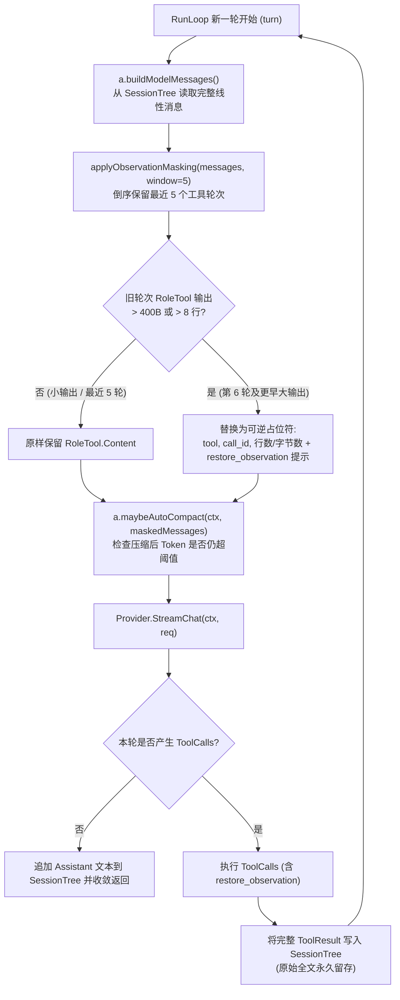
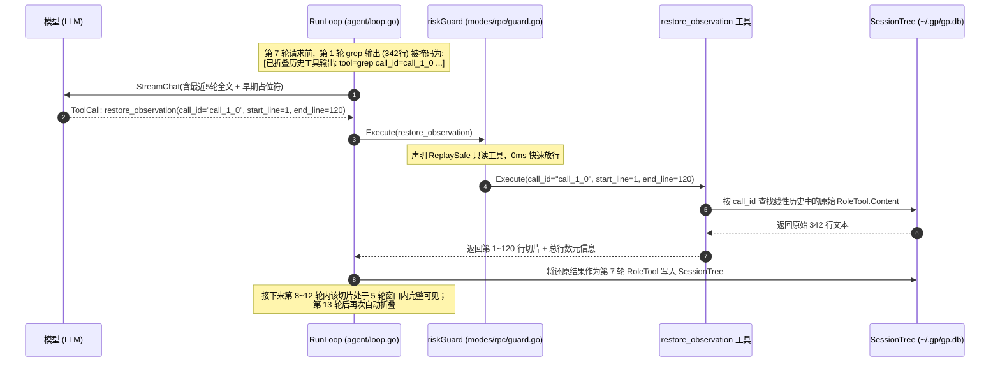

# Observation Masking 与 DTOC 上下文防污染设计方案

> **适用项目**：`gp`（Go Agent Harness）  
> **关联模块**：`internal/agent/loop.go`、`internal/agent/compact.go`、`internal/core/session/session.go`、`internal/modes/rpc/guard.go`

---

## 1. 背景与问题

在长周期 Coding / 运维排查会话中，`gp` 通过 `SessionTree`（`~/.gp/gp.db`）持久化完整历史消息。由于 `bash`、`grep`、`read` 等工具的输出通常占据总 Token 的 ~80% 以上，随着多轮排查推进，哪怕用户只发送一句简单的 `hello`，也会把大量早已消费完毕的历史工具原文重新拼进 `ChatRequest.Messages`，导致输入 Token 动辄飙升至 100k–150k+，既增加延迟与成本，也容易引发上下文腐烂（Context Rot）。

结合两篇论文的核心结论，本方案采用 **0ms 滑动窗口 Observation Masking + 可逆 DTOC 按需还原**，在不修改数据库原始记录的前提下从源头控制输入体积：

1. ***The Complexity Trap: Simple Observation Masking Is as Efficient as LLM Summarization for Agent Context Management***：保留完整推理链与工具调用参数，仅对较早轮次的冗长 `RoleTool` 输出做轻量占位符掩码，效果不输 LLM 摘要且 0 额外模型延迟与幻觉风险。
2. ***DTOC: Dynamic Tool Output Compression for Adaptive Context Management in AI Agents***：原始工具输出完整保留在外部存储（`SessionTree`）中，上下文仅放带 ID 的可逆占位符；当模型后续确实需要回看旧输出时，通过工具按 ID 按需恢复。

---

## 2. 核心设计原则

1. **存储与视图分离（不破坏 `SessionTree`）**
   - `~/.gp/gp.db` 永远写入并保留完整的 `RoleTool.Content`，保证 `/resume`、历史回溯及按需还原有完整源数据。
   - 仅在 `RunLoop` 每次调用 `StreamChat` 前，对构造出的 `messages` **视图副本**执行 0ms 掩码。
2. **滑动窗口 = 5 轮**
   - 从 `messages` 末尾倒序统计带 `ToolCalls` 的 `RoleAssistant` 消息，**最近 5 轮**的工具输出 100% 原样保留；第 6 轮及更早的工具输出进入掩码判断。
3. **小结果豁免**
   - 对于本身很短的工具输出（`<= 400` 字节且 `<= 8` 行，如 `ok`、`wrote 10 lines`），直接保留原文，不做无意义的占位符替换。
4. **可逆按需还原（`restore_observation`）**
   - 提供只读内置工具 `restore_observation(call_id, start_line, end_line)`，支持模型按 `call_id` 从 `SessionTree` 精确取回被折叠的历史输出片段。

---

## 3. 调用流程

### 3.1 RunLoop 整体消息构建与掩码流程



### 3.2 DTOC 按需还原调用时序（`restore_observation`）



---

## 4. 详细设计

### 4.1 掩码算法（`applyObservationMasking`）

1. **输入**：`messages []ai.Message`、`windowTurns int`（默认 `5`，`<= 0` 时跳过掩码）。
2. **定位窗口边界**：
   - 从 `len(messages) - 1` 向前遍历，统计 `m.Role == ai.RoleAssistant && len(m.ToolCalls) > 0` 的数量。
   - 当计数达到 `windowTurns`（第 5 个工具调用轮次）时，记录该 `RoleAssistant` 的下标 `cutoffIdx`；若总工具轮次不足 5 轮，直接原样返回。
   - 构建 `callID -> toolName` 映射表（遍历所有 `RoleAssistant.ToolCalls`）。
3. **生成视图副本**：
   - 对于 `i < cutoffIdx` 且 `messages[i].Role == ai.RoleTool` 的消息：
     - 若 `!shouldMaskObservation(m.Content)`（字节数 `<= 400` 且行数 `<= 8`），保留原样。
     - 否则复制该 `ai.Message`，将 `Content` 替换为：
       ```text
       [已折叠历史工具输出: tool=<toolName> call_id=<ToolCallID> | 原文 <lines> 行 / <bytes> 字节; 若后续确需查看原文，请调用 restore_observation(call_id="<ToolCallID>")]
       ```
     - 若消息携带 `Images` 等多模态附件，历史轮次可按需保留元信息或随同提示，避免重复发送历史大图（首期优先处理文本 `Content`）。

### 4.2 为什么 `applyObservationMasking` 放在 `maybeAutoCompact` 之前？

- 顺序调整为：`buildModelMessages()` → `applyObservationMasking(..., 5)` → `maybeAutoCompact(...)`。
- 好处：先用 **0ms 掩码**把旧工具输出体积压下来，再让 `maybeAutoCompact` 估算 Token；原本可能触发 `Compact()` 的 150k 会话，掩码后往往降到 20k–40k，**直接省掉不必要的 LLM 摘要请求**。
- 注意：`maybeAutoCompact` 若确实触发 `Compact()`，仍从 `a.sessionTree` 读取完整历史做摘要，不受视图掩码影响，保证摘要不丢信息；摘要后再次 `buildModelMessages()` 时也应再过一次 `applyObservationMasking(..., 5)`。

### 4.3 `restore_observation` 工具契约

| 字段 | 类型 | 必填 | 默认值 | 说明 |
| :--- | :--- | :--- | :--- | :--- |
| `call_id` | `string` | 是 | — | 被折叠占位符中提示的 `call_id` |
| `start_line` | `integer` | 否 | `1` | 起始行号（1-based） |
| `end_line` | `integer` | 否 | `start_line + 199` | 结束行号（单次最多返回 200 行，防止一次性撑爆当前窗口） |

- **安全属性**：实现 `tools.ReplayableTool` 返回 `tools.ReplaySafe`；在 `riskGuard` 的 `isSensitiveTool` 中直接归为只读安全工具，**0ms 放行，不触发 LLM 审计或管理员审批**。
- **边界处理**：
  - 未找到 `call_id`：返回明确提示（`未在当前会话历史中找到 call_id=... 的工具输出`）。
  - 返回格式：附带 `[call_id=<id> | 第 <start>-<end> 行，共 <total> 行]` 头部，方便模型判断是否需要继续翻页。

### 4.4 配置项

在 `AgentInstance` 增加：
- `observationMaskWindow int`（默认值 `5`）
- `SetObservationMaskWindow(turns int)` / `GetObservationMaskWindow() int`（`<= 0` 表示禁用掩码）

---

## 5. 测试验证计划

1. **窗口边界单测**：构造 7 轮工具调用历史，验证第 3–7 轮（最近 5 轮）`RoleTool` 原文完整保留，第 1–2 轮大输出被掩码，小输出（如 `ok`）豁免不被掩码。
2. **数据库完整性单测**：验证掩码后 `SessionTree` 中的原始 `RoleTool.Content` 未被修改。
3. **DTOC 还原单测**：调用 `restore_observation(call_id, start_line, end_line)` 能精确还原第 1 轮被掩码的原文切片，且越界行号/不存在的 `call_id` 返回安全提示。
4. **AutoCompact 联动单测**：验证大历史经过 5 轮掩码后 Token 估算显著下降，不会误触发 `Compact()`。
